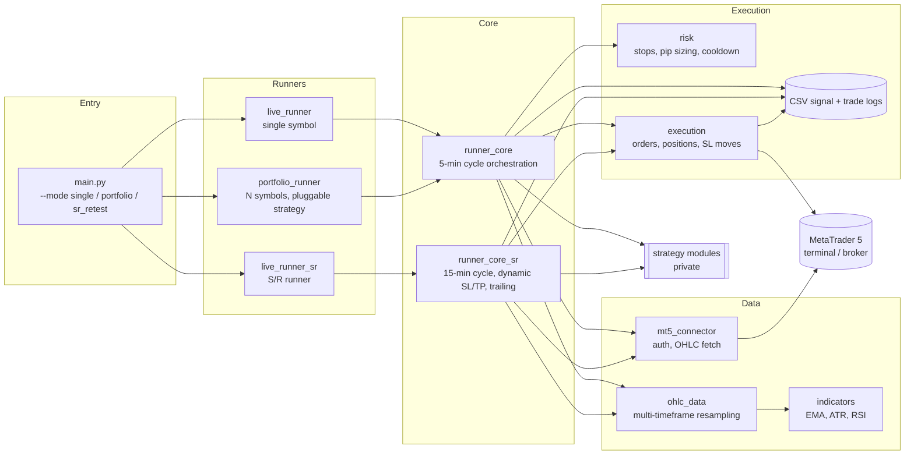

# MQL5 Momentum Trading Bot

An end-to-end algorithmic trading system in Python that connects to **MetaTrader 5**, pulls live market data, evaluates multi-timeframe signals and manages orders and risk automatically across a portfolio of FX, metals, energy and crypto symbols.

> **Note:** this is a public showcase of the architecture. The strategy logic, tuned parameters, backtests, research notebooks and the native MQL5 Expert Advisors live in a private repository. The strategy modules here are documented stubs that define the interface.

## Architecture



### How a cycle works

1. **Schedule.** Each runner sleeps until the next closed trigger bar (5 or 15 min), plus a small buffer so MT5 has published the bar.
2. **Data.** `mt5_connector` fetches about 30 days of 1-minute bars. `OHLCData` resamples them into every timeframe the strategy needs and attaches indicators.
3. **Signal.** The runner calls an injected `compute_signal(ohlc)` function. Strategies are plain functions that return a signal dict, so the portfolio runner can swap strategies from config without touching the execution code.
4. **Risk.** `risk` resolves per-symbol pip size from broker metadata, computes the broker-side stop (clamped to the symbol's minimum stop distance) and enforces a re-entry cooldown.
5. **Execution.** `execution` sends market orders with SL/TP, finds positions by *magic number* (each runner owns its own range, so bots never fight over a position), closes positions, and ratchets stops.
6. **Audit.** Every decision (entry, skip and its reason, exit, stop hit, trail) is appended to CSV logs for later analysis.

## Project layout

```
main.py                   CLI entry point
config/
  pairs.example.py        per-symbol lot / stop / pip-size config (template)
  .env.example            MT5 credentials template
src/
  mt5_connector.py        MT5 session + OHLC retrieval
  ohlc_data.py            multi-timeframe container & resampler
  indicators.py           EMA, EMA trend, ATR (Wilder), RSI (Wilder)
  risk.py                 pip sizing, stop placement, stop reconcile, cooldown
  execution.py            order routing, position lookup, SL/TP modification, trade log
  runner_core.py          per-symbol cycle for the 5-min strategies
  runner_core_sr.py       per-symbol cycle for the 15-min S/R strategy
  live_runner*.py         single-symbol loops
  portfolio_runner.py     multi-symbol loop with strategy registry
  strategy*.py, zones.py  strategy interface stubs (implementation private)
  synthetic_ohlc_gen.py   synthetic OHLC generator for Monte Carlo testing
tools/
  stream_prices.py        live tick streamer (single / multiple symbols)
mql5/                     native Expert Advisors (private)
```

## Running

Requires Windows with a MetaTrader 5 terminal installed and logged in (the `MetaTrader5` Python package talks to the local terminal).

```bash
pip install -r requirements.txt
cp config/pairs.example.py config/pairs.py
cp config/.env.example config/.env   # fill in your MT5 login
python main.py --mode portfolio
```

The public strategy stubs raise `NotImplementedError`. To run the bot, add your own `compute_signal` that follows the documented contract.

## Tech

Python · pandas · NumPy · MetaTrader5 API · MQL5
